# TamaDigi

  

Ein **Digimon-V-Pet** für das **Waveshare ESP32-S3-Touch-AMOLED-1.75**: rundes 466×466-AMOLED, Touch, Akku, Lautsprecher.
Du ziehst ein Digimon aus dem **Digi-Ei** groß. Wie gut du es pflegst und trainierst und wie viele Kämpfe es gewinnt, entscheidet, **zu welchem Digimon es digitiert**.

> **Herkunft:** Das Projekt basiert auf der TamaPoke-Engine (Original von **Quique Tortosa** – [socquique/TamaPoke](https://github.com/socquique/TamaPoke), Fork von [DylanPDao](https://github.com/DylanPDao/TamaPoke) und [eperdeme](https://github.com/eperdeme/TamaPoke)). Display, Touch, Sound, Speicherstände, Kampfsystem, Emulator und Web-Installer stammen von dort. TamaDigi ersetzt die Pokémon-Inhalte vollständig durch Digimon-Inhalte und Digimon-Regeln.
>
> **Nicht-kommerzielles Fan-Projekt.** Der Code steht unter MIT. Digimon, alle Namen und die Pixelgrafiken (aus *Digimon Color*) sind © Bandai / Toei Animation. Siehe [CREDITS.md](CREDITS.md).

## Bildschirme

Alle Bilder stammen direkt aus dem Emulator (`bash tools/make_screens.sh`) und zeigen genau das, was das Display zeichnet.

| Dein Digimon | Digi-Ei | Version wählen |
|---|---|---|
| 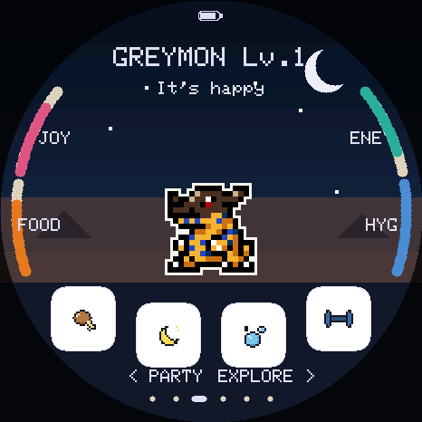 | 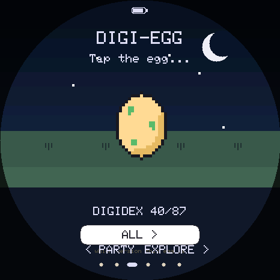 | 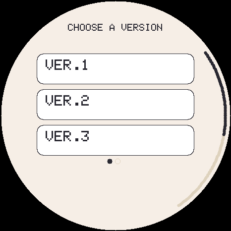 |

| Kampf | Attacke wählen | Wildes Digimon | Erkunden |
|---|---|---|---|
| 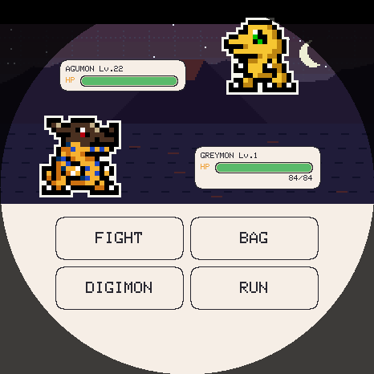 | 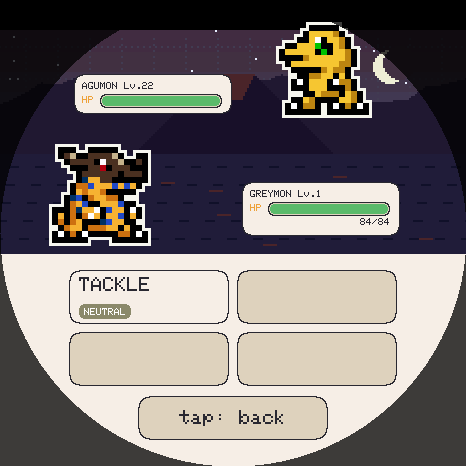 | 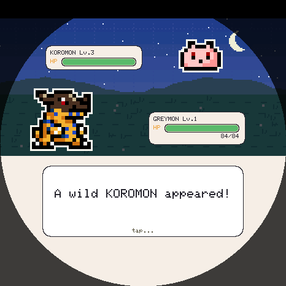 | 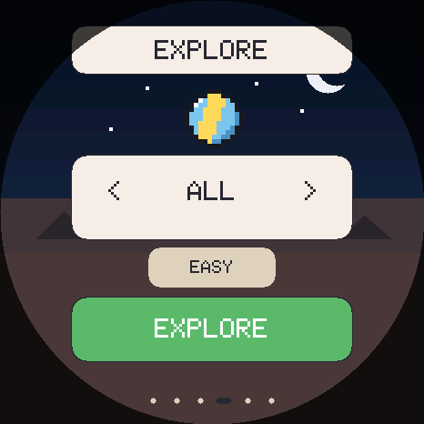 |

| Boss-Leitern | Ver.2-Bosse | Sieg | Team wählen |
|---|---|---|---|
| 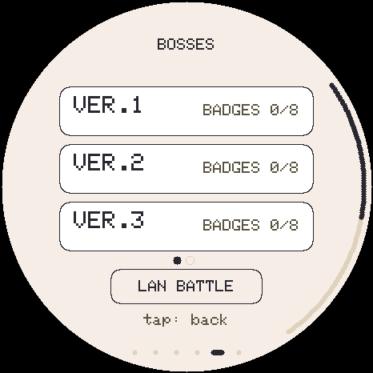 | 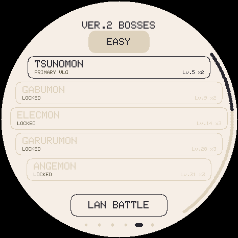 | 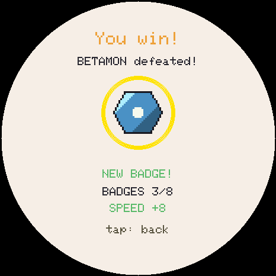 | 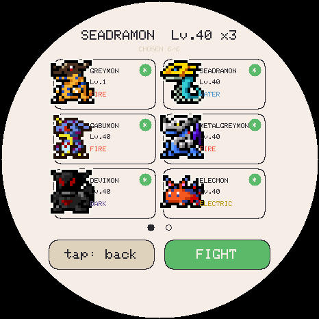 |

| Digidex | Ver.1 | Ver.2 | Box |
|---|---|---|---|
| 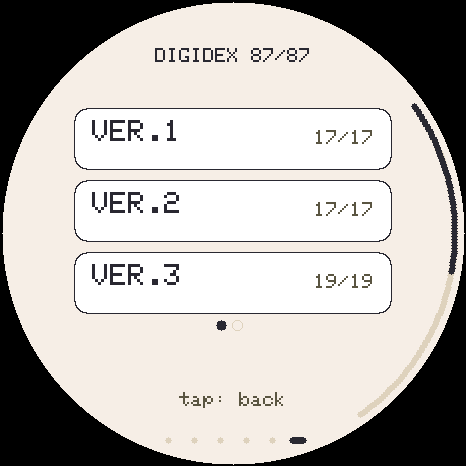 | 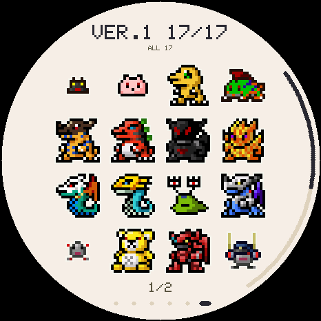 | 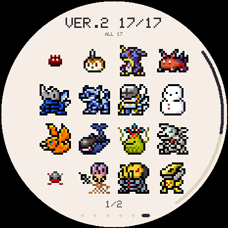 | 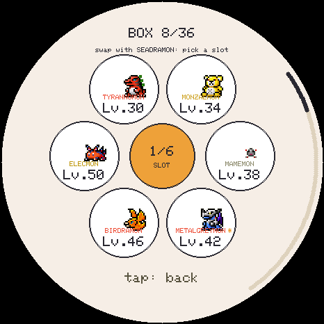 |

| Tamer-Karte | Abzeichen | Attacken | LAN-Kampf |
|---|---|---|---|
| 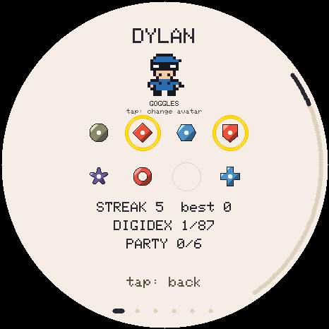 | 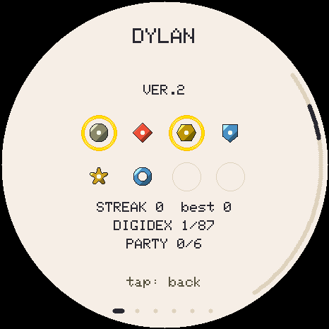 | 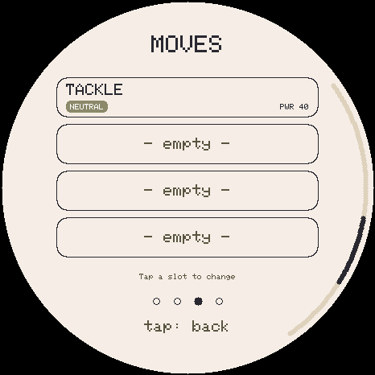 | 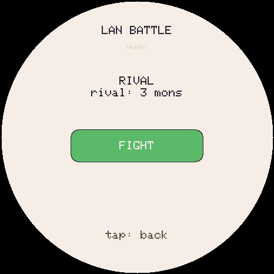 |

## Was anders ist als bei Pokémon

| | TamaPoke | **TamaDigi** |
|---|---|---|
| Wachstum | Entwicklung nach Level, alle Werte ≥ 40 | **Digitation** nach Alter; die *Pflege* wählt den Zweig |
| Stufen | Basis → Phase 1 → Phase 2 | **Digi-Ei → Baby I → Baby II → Rookie → Champion → Ultra → Mega** |
| Typen | 18 Pokémon-Typen | **9 Elemente** + **Attribut-Dreieck** Impfstoff > Virus > Daten > Impfstoff |
| Regionen | Kanto, Johto … | **V-Pet-Versionen**: Ver.1 bis Ver.5 |
| Fangen | Pokébälle | **Scan-Chips** (Scan, Super, Hyper, Meister) |
| Heilen/Training | Tränke, Protein … | **Heil-Disks** (S/M/L), Allheil-Disk, Angriffs-/Verteidigungs-/Tempo-Chip |
| Futter | Beeren, Süßigkeit | **Fleisch, Fisch, Pilz** (jedes Digimon hat ein Lieblingsessen), **Protein** |
| Arenen | Arenaleiter + Orden | **Boss-Leitern** je Version + eigene Abzeichen |
| Shiny | Shiny-Pokémon | seltene **Farbvariante** |
| Grafik/Musik | Nintendo-Material | farbige Digimon-Color-Sprites; Musik, Abzeichen, Avatare und Hintergründe sind **eigene Werke** |

## Digitation – so funktioniert sie

Ein Level entspricht einer Stunde Echtzeit. Ist die Zeit einer Stufe um, erscheint der **Digitations-Knopf**. Tippst du ihn an, siehst du die Digitation; mit „Form behalten“ verschiebst du sie. **Welches** Digimon herauskommt, entscheidet der erste passende Zweig:

| Stufe | Digitiert ab | Was den Zweig bestimmt |
|---|---|---|
| Baby I → Baby II | Lv. 2 (1 h) | – |
| Baby II → Rookie | Lv. 7 (6 h) | **Pflegefehler:** 0–2 → erster Rookie, sonst der zweite |
| Rookie → Champion | Lv. 25 (24 h) | **Pflegefehler** (0–2 / 3–5 / mehr) × **Training** (≥ 40 / weniger) |
| Champion → Ultra | Lv. 49 (48 h) | **5 gewonnene Kämpfe** in dieser Stufe |
| Ultra → Mega | Lv. 61 (60 h) | **15 gewonnene Kämpfe** in dieser Stufe |

- **Pflegefehler**: Ein Bedürfniswert (Essen, Freude, Energie, Hygiene) fällt auf 10 oder darunter (höchstens einer pro Stunde).
- **Training**: die Summe aus Stärke, Abwehr und Tempo (Boxsack, Reaktionstest, Ball-Spiel, Siege, Chips).
- Pflegefehler und Siege **zählen ab jeder Digitation neu**, wie beim echten V-Pet.
- Ein Champion ohne Siege bleibt Champion. Das Lebensende erreicht er trotzdem: Nach 3 Tagen kann sich jedes Digimon ab Champion **verabschieden** und kommt dann ins Team.
- Die Karte **FORTSCHRITT** (auf der Statuskarte nach oben wischen) zeigt Pflegefehler, Training, die Stunden bis zur Digitation und fehlende Siege.

Beispiel Ver.1 – **Agumon** wird zu:

| | Training ≥ 40 | Training < 40 |
|---|---|---|
| **0–2 Pflegefehler** | Greymon | Tyrannomon |
| **3–5 Pflegefehler** | Devimon | Meramon |
| **mehr** | Numemon | Numemon |

Greymon, Devimon und Airdramon werden mit 5 Siegen zu **MetalGreymon**, Tyrannomon, Meramon und Seadramon zu **Mamemon**, Numemon zu **Monzaemon**. Mit 15 weiteren Siegen werden daraus die Megas **BlitzGreymon**, **BanchoMamemon** und **ShinMonzaemon**.

## Die Versionen

| Version | Digi-Ei | Digimon | Megas |
|---|---|---|---|
| **Ver.1** | Botamon | 17 | BlitzGreymon, BanchoMamemon, ShinMonzaemon |
| **Ver.2** | Punimon | 17 | SkullMammon, CresGarurumon, Ebemon |
| **Ver.3** | Poyomon | 19 | HiAndromon, Gokumon, BanchoLeomon, **Millenniumon** |
| **Ver.4** | Yuramon | 17 | Darkdramon, BloomLordmon, Gankoomon |
| **Ver.5** | Zurumon | 17 | Machinedramon, Raidenmon, Gaioumon |
| **ALL** | eins der fünf | gemischt | |

Zusammen sind das **87 Digimon**, jedes mit eigener farbiger Grafik. Die Bäume folgen den V-Pets bzw. *Digimon Color*. Die Bedingungen der Zweige sind an das Stundentempo dieses Spiels angepasst. Alles steht in einer Datei: [`tools/digimon_data.py`](tools/digimon_data.py).

**Ver.3-Sonderweg:** Sukamon wird mit 10 Siegen zu **Chimairamon**, sonst mit 5 zu Etemon. Chimairamon wird mit 20 Siegen zu **Millenniumon**, mit 15 zu BanchoLeomon.

## Kampf

- Rundenbasiert mit 4 Attacken. Signatur-Attacken kommen mit der Digitation (Pepper Breath, Mega Flame, Giga Destroyer …).
- **Element-Tabelle** (Feuer, Wasser, Pflanze, Elektro, Wind, Erde, Licht, Dunkel, Neutral) mit 2×/½× und ohne Immunitäten.
- **Attribut-Dreieck:** Impfstoff schlägt Virus, Virus schlägt Daten, Daten schlägt Impfstoff (×1,3 bzw. ×0,8). Babys sind *Frei* und neutral.
- **Erkunden:** wilde Digimon passend zu deinem Level (Level 10 → Rookies, ab Level 25 auch Champions). Schwäch sie und nutz einen **Scan-Chip**, um ihre Daten in Team oder Box zu übernehmen.
- **Boss-Leitern:** je Version 8 Gebiete, 4 Elite-Bosse und ein Champion, auf Leicht und Schwer. Siege trainieren dein Digimon und zählen für die Digitation.
- **LAN-Kampf** zwischen zwei Geräten per ESP-NOW.

## Hardware

- [Waveshare ESP32-S3-Touch-AMOLED-1.75](https://www.waveshare.com/wiki/ESP32-S3-Touch-AMOLED-1.75): die **Standard**- oder **-G**-Version, **nicht „-B“**
- 466×466 AMOLED (CO5300, QSPI), Touch CST9217, AXP2101 (Akku/PWR), PCF85063 (RTC), microSD, ES8311 (Sound)
- microSD-Karte im Slot (die Sprites liegen dort)

## Installation

### Variante A: Web-Installer (empfohlen, nichts installieren)

1. **https://joop0810.github.io/TamaDigi/web/** in **Chrome oder Edge** öffnen (Firefox und Safari können kein Web Serial).
2. Board per USB-C anstecken, **Install firmware** klicken und den Port wählen.
3. Weiter unten die **Versions-Packs** (Sprites) auf die SD-Karte senden: Ver.1–Ver.5, einzeln oder alle.
4. Fertig. Sprache am Gerät: Namen antippen → SETTINGS → Sprachzeile antippen (bis „DE“).

**Eigener Fork:** Repo forken, in `web/editions.json`, `web/index.html` und `web/installer.js` `joop0810` durch deinen GitHub-Namen ersetzen, unter **Settings → Pages → Source** „GitHub Actions“ wählen und auf `main` pushen. Der Workflow kompiliert die Firmware in der Cloud und veröffentlicht deinen eigenen Installer.

### Variante A2: `start.bat` (Windows, lokal)

Doppelklick auf **`start.bat`** im TamaDigi-Ordner. Das Skript

- lädt die zuletzt von GitHub gebaute Firmware von der Pages-Seite herunter, oder
- nimmt sie aus **`tamadigi-firmware.zip`**, falls es keine Pages-Seite gibt (z. B. ein privater Fork). Die Datei bekommst du unter **GitHub → Actions → letzter Lauf → Artifacts → tamadigi-firmware**. Lass sie im Download-Ordner oder leg sie neben `start.bat`.
- Danach startet es einen kleinen lokalen Server und öffnet den Installer unter `http://localhost:8765/web/` in Chrome oder Edge.

Alles Weitere (Firmware flashen, Sprites auf die SD, Spielstand sichern) geht dort wie in Variante A. Python oder Arduino brauchst du dafür nicht, nur die PowerShell, die in Windows dabei ist. Zum Beenden das schwarze Fenster schließen.

### Variante B: Arduino lokal

- Board: **ESP32S3 Dev Module** · Flash **16MB** · PSRAM **OPI PSRAM** · Partition Scheme **16M Flash (3MB APP/9MB FATFS)** · USB CDC On Boot **Enabled**
- Bibliotheken: GFX Library for Arduino 1.6.7, SensorLib 0.4.1, XPowersLib 0.3.3, ESP32-Core 3.3.11

```bash
FQBN="esp32:esp32:esp32s3:CDCOnBoot=cdc,FlashSize=16M,PSRAM=opi,PartitionScheme=app3M_fat9M_16MB"
arduino-cli compile --fqbn "$FQBN" .
arduino-cli upload -p COM5 --fqbn "$FQBN" .
python3 tools/unpack_bundle.py   # Sprites aus web/sprites-*.pak auspacken
python3 tools/send_sd.py         # und per USB auf die SD schicken
```

## Sprites

Die Digimon sind die **farbigen Pixel-Sprites aus *Digimon Color*** (Bandai), wie sie das Projekt [furudbat/wayland-vpets](https://github.com/furudbat/wayland-vpets) (`assets/dmc/`) sammelt. Jedes Digimon hat dort ein Blatt mit 9–13 Bildern: Stehen, Freude, Wut, Essen, Schlafen, Verweigern, Traurig, Niederlage und Angriff. Daraus entstehen die Animationen (Laufen, Essen, Schlafen, Treffer, Angriff, Nicken). Ein heller Rand hält die Figur auch nachts auf dunklem Himmel sichtbar. Die seltene **Farbvariante** ist dieselbe Grafik mit verschobenem Farbton.

```bash
python3 tools/pack_sprites.py   # holt die Quellbilder (einmal), erzeugt tools/sdcard/mons/*.bin + noart.h
python3 tools/make_thumbs.py    # Digidex-Miniaturen
python3 tools/pack_bundle.py    # web/sprites-<version>.pak für den Installer
```

Die fertigen Packs liegen schon in `web/sprites-ver1.pak` … `ver5.pak`. Du musst die Befehle nur ausführen, wenn du Digimon hinzufügst oder die Grafik änderst. Ein Digimon ohne Grafik landet in `noart.h` und schlüpft dann nie und ist kein Digitationsziel.

## So spielst du

- **Unten**: 🍖 Füttern (Fleisch/Fisch/Pilz oder Protein) · 🌙 Licht/Schlafen · 🫧 Baden · 🏋 Training (Boxsack → Stärke, Reaktion → Tempo, Ball → Abwehr, Gedächtnisspiel → Freude)
- **Wischen**: horizontal durch `TAMER · TEAM · [DIGIMON] · ERKUNDEN · BOSSE · DIGIDEX`, hoch = Statuskarte, runter = zurück, am Rand ziehen = blättern
- **Name antippen** = Menü (Beutel, Einstellungen, Verabschieden); **Digimon antippen** = streicheln; **3 s halten** = freilassen
- **Nachts** (0–6 Uhr, Bildschirm aus) schläft dein Digimon von selbst, damit es nicht über Nacht wegläuft. Dafür muss die Uhrzeit in den Einstellungen gestellt sein.
- **PWR kurz** = Bildschirm an/aus, **lang (4 s)** = ausschalten (die Uhr läuft weiter, dein Digimon altert also auch ausgeschaltet)
- Sprache: Englisch (Standard), **Deutsch**, Spanisch, Französisch, Italienisch, Portugiesisch – in den Einstellungen

## Am PC ausprobieren: Emulator

`tools/emu/` übersetzt die **echte Firmware** in ein Desktop-Programm, nur die Hardware wird nachgebildet.

```bash
sudo apt install libsdl2-dev          # macOS: brew install sdl2
python3 tools/unpack_bundle.py
bash tools/emu/build.sh
tools/emu/tamadigi-emu --scale 2 --fast 60   # 60x Zeitraffer: ein Leben in ~1 h
```

## Tests

```bash
TAMA_TEST_BACKEND=host bash tools/emu/tests/run.sh           # alle Suiten im Emulator
TAMA_TEST_BACKEND=host bash tools/emu/tests/run.sh digivolve # nur eine
```

48 Suiten, darunter `digivolve_test` (alle Zweige von Ver.1, Siege, Stufenuhr, Megas in jeder Version, kein Zweig zu einem Digimon ohne Sprite), Kampf, Speichern bei Stromausfall, Web-Installer und Touch. GitHub Actions führt sie bei jedem Push aus und kompiliert dabei auch die echte ESP32-Firmware.

## Serielle Konsole (115200)

`STATS` · `SPEC <dex>` · `LVL <n>` · `MISS <n>` (Pflegefehler) · `TR <atk> <def> <spe>` · `HATCH` · `EGG <dex>` · `VARIANT` · `WILD` · `BATTLE <dex> <lvl>` · `BYE` · `RUN` · `WIPE` · `EXPORT` / `IMPORT` (Spielstand sichern) · `LS` / `PUT` (SD-Dateien)

## Lizenz

- **Code** (Firmware + Tools): MIT, © 2026 Quique Tortosa und Mitwirkende, Digimon-Umbau © 2026 Dennis.
- **Digimon, Namen, Sprites**: © Bandai / Toei Animation. Nur private, nicht-kommerzielle Nutzung.
- **Musik, Abzeichen, Avatare, Kampfhintergründe, UI-Icons**: in diesem Projekt erzeugt (siehe `tools/gen_music.py`, `gen_ladders.py`, `gen_avatars.py`, `draw_backs.py`, `sprites.py`), MIT.

Inoffizielles Fan-Projekt. Nicht mit Bandai oder Toei verbunden oder von ihnen unterstützt.
