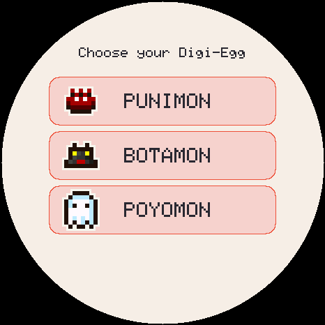
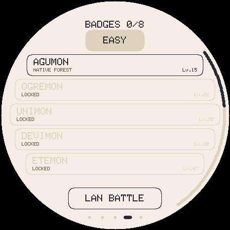

# TamaDigi: Time Stranger fork

  

A custom fork of **TamaDigi**, the **Digimon V-Pet** for the **Waveshare ESP32-S3-Touch-AMOLED-1.75** (a round 466×466 AMOLED with touch, battery and speaker). The goal is to rebuild it around the roster and evolution tree of ***Digimon Story: Time Stranger***.

> **Status (October 2026):** the firmware runs on the Time Stranger data: the roster, the routes, the stats, the skills and the elements, described under [The current firmware](#the-current-firmware). The rest of the rework (Agent Rank, the real boss ladder, the Digidex and more) is still to come, under [Planned](#planned). A public build has art for only 73 of the 469 forms, so those are the ones you meet. Saves from v1.0.0 are not carried forward: the firmware says so and starts a new game.
>
> **Non-commercial fan project.** The code is MIT licensed. Digimon, all names and all game art are © Bandai / Bandai Namco / Toei Animation. See [CREDITS.md](CREDITS.md).

## Where it comes from

| | Author | What they added |
|---|---|---|
| [socquique/TamaPoke](https://github.com/socquique/TamaPoke) | Quique Tortosa | The original pet: care, stats, evolution, display, touch, sound, saves, the first web installer |
| [DylanPDao/TamaPoke](https://github.com/DylanPDao/TamaPoke) | Dylan Dao | Battles, party, gyms, more regions, LAN battle, the desktop emulator, level cap, auto-sleep |
| [eperdeme/TamaPoke](https://github.com/eperdeme/TamaPoke) | Nathan Flynn | Up to v4.1.1: the rebuilt web installer, faster sprite packs, tests on an ESP32-S3 emulator, save migration |
| [joop0810/TamaDigi](https://github.com/joop0810/TamaDigi) | joop0810 | Replaced the Pokémon content with Digimon content and rules |
| **this repo** | jaredbt | The Time Stranger rework |

joop0810 published TamaDigi as a single commit with no history. This repo puts that commit back on top of eperdeme's v4.1.1, so `git log` and `git blame` reach every author back to socquique's first commit.

## This fork

### Done so far

- **Full history restored** (see above).
- **Everything in English**: source comments, serial logs, tool output, scripts and docs. The six UI languages are unchanged.
- **A new backdrop**: an original V-Pet-style landscape that fills the whole screen, with a day and a night version (`art/backdrops/`). It is not drawn by the firmware yet.

  | Day | Night |
  |---|---|
  |  |  |

- **A pre-render pipeline** (`tools/prerender/`) that captures Time Stranger's 3D Digimon models as animated sprites in the firmware's TPK2 format. It uses a locally run copy of Nuffle's [DSTS Model Viewer](https://tangled.org/nuffle.me/dsts-viewer) (MIT). The captured frames cover every action the firmware plays (idle, walk, sleep, eat, hurt, attack, cheer, nod, deep breath) and two new ones (sad and special attack).
- **Emulator start time:** `EMU_EPOCH=<unix seconds>` sets the virtual clock, for testing day and night.
- **A baseline release, [v1.0.0](https://github.com/jaredbt/TamaDigi/releases/tag/v1.0.0):** joop0810's game as it was, so there is a known-good firmware to flash first and to roll back to. This fork's installer is live at https://jaredbt.github.io/TamaDigi/web/.
- **Tests that pass:** the firmware tests had failed since the Digimon conversion (a save-migration test still used Pokémon dex numbers). They pass now, and the old-save upgrade test the conversion deleted is back, with a frozen v1.0.0 save that later builds must keep loading.
- **The Time Stranger data** the rework needs (`tools/data/time-stranger/`): every Digimon's stats, evolution requirements, attribute, elemental weaknesses and skills, plus an audit of what the conversion has to handle.
- **The cutover, phase 1:** the firmware now runs on that data. One roster with no V-Pet versions, seven raisable stages, Time Stranger's stat growth, routes, skills, elements and statuses, and a new save format.

> **Private builds only.** The models, and every frame rendered from them, are Bandai Namco's assets. `tools/prerender/.gitignore` keeps them out of the repo, and they must never be committed or published. A public build would need other art.

### Planned

The decisions, all recorded in [docs/HANDOFF.md](docs/HANDOFF.md):

- **Eggs and the wild**: the first egg hatches a random In-Training I. Armor, Hybrid and a few forms that need Time Stranger-only mechanics can be met in the wild but not raised.
- **Progress**: a 13-boss ladder of villains from the first two anime seasons (DemiDevimon up to Apocalymon) sets an Agent Rank, with an optional Hard mode; no battling is needed up to Champion. A Digidex by stage fills in as you see, scan (three wild wins or one boss win) and raise Digimon. Fusion (Jogress) with a past partner or a defeated wild Digimon is a stretch goal.
- **Firmware work**: more frames per action, larger sprite files, the new sad and special-attack slots, the attack animation chosen by skill type, longer battle animation windows, and the new backdrop. socquique's later battery and drawing improvements should be ported too.

Still open: how evolution and the 72-hour farewell are offered, battle timing and balance, and art for a public build.

## The current firmware

Everything in this section describes the firmware as it is today. The boss ladder, the wild encounters, the eggs and the Digidex are simple stand-ins on the new data until the next phase replaces them.

You raise a Digimon from a **Digi-Egg**. How you train it decides **which Digimon it can digivolve into**, and you choose among what is open.

### Screens

Every image comes straight from the emulator (`bash tools/make_screens.sh`) and shows exactly what the display draws.

| Your Digimon | Digi-Egg | Choose a starter |
|---|---|---|
|  |  |  |

| Battle | Choose a skill | Wild Digimon | Explore |
|---|---|---|---|
|  |  |  |  |

| Boss ladder | Victory | Digidex |
|---|---|---|
|  |  |  |

| Tamer card | Skills | LAN battle |
|---|---|---|
|  |  |  |

### How it differs from TamaPoke

| | TamaPoke | **TamaDigi** |
|---|---|---|
| Growth | Evolution by level, all stats ≥ 40 | **Digivolution** you choose among Time Stranger's routes, opened by age and training |
| Stages | Basic → Stage 1 → Stage 2 | **Digi-Egg → In-Training I → In-Training II → Rookie → Champion → Ultimate → Mega → Mega+** |
| Types | 18 Pokémon types | **11 elements**, a resistance row per Digimon, and the **attribute triangle** Vaccine > Virus > Data > Vaccine |
| Catching | Poké Balls, a party and a box | **None**: one partner at a time, and every battle is 1-on-1 |
| Healing/training | Potions, Protein … | **Recovery disks** (S/M/L), ALL CURE, Attack/Defence/Speed chip |
| Food | Berries, candy | **Meat, fish, mushroom** (every Digimon has a favourite food), **protein** |
| Gyms | Gym leaders + badges | A **boss ladder** with its own badges |
| Shiny | Shiny Pokémon | a rare **colour variant** |
| Art/music | Nintendo material | coloured Digimon Color sprites; the music, badges, avatars and backgrounds are **original work** |

### One roster

Time Stranger's **469 forms**, in its Field Guide order, in seven raisable stages: In-Training I, In-Training II, Rookie, Champion, Ultimate, Mega and Mega+. There are no V-Pet versions any more. A form with no art never hatches, evolves or appears, and the public sprites cover **73** of them, starting from the three In-Training I forms Punimon, Botamon and Poyomon.

### Raising

- **Stats** grow in a straight line from Time Stranger's level-1 values to its level-99 ones, at one level an hour, scaled by a tenth, plus training. Training goes up to 255 on every stat, whatever the IV: a session pays 70% at IV 0 and 130% at IV 31. ATK training also raises magic attack, DEF training also raises magic defence.
- **HP** grows with age only. Each de-digivolution multiplies it by a further 10%, up to double.
- **Digivolution** is yours to choose: the branches whose stat, age and stage-timer conditions are met are offered, and never forced. "Keep form" asks again next level, with the next open branch.
- **De-digivolution**, from the status card's progress page, goes back to any earlier form in your Digidex. The form then waits out its stage again.
- **Skills**: four slots. Becoming a form gives its special skills at once and its attachment skills over the hours after. A free slot fills silently, a full set makes an offer, and a skill you drop is gone until you become a form that has it. Skills carry over between forms.

### Battle

- Turn-based, 1-on-1, your partner against one opponent. Four skills plus a basic attack that is always there.
- **Elements**: Time Stranger's eleven. Each Digimon has its own row of how much each one hurts it, from nothing to double. A form's own element, the one its signature attack uses, gets a ×1.5 bonus.
- **Attribute triangle:** Vaccine beats Virus, Virus beats Data, Data beats Vaccine (×1.3 or ×0.8); the rest are neutral.
- **Learnable skills** grow with the partner's level: tier I below 25, II at 25-60, III from 61. Multi-hit skills always land their full count of hits.
- **Six statuses**: Injury (chip damage and halved physical attack), Crystallization (no actions until it wears off, or ALL CURE), Poison, Paralysis, Sleep and Confusion. No element is immune to any of them.
- **Explore:** wild Digimon matched to your level. Wins can drop items. Nothing is caught.
- **The boss ladder:** one ladder of 13, on Easy and Hard, each boss a single Digimon. Victories train your Digimon.
- **The bag:** recovery disks, ALL CURE and stat chips.
- **LAN battle** between two devices over ESP-NOW.

### Sprites

The Digimon are the **coloured pixel sprites from *Digimon Color*** (Bandai), as collected by the [furudbat/wayland-vpets](https://github.com/furudbat/wayland-vpets) project (`assets/dmc/`), mapped onto their Time Stranger forms by name in `tools/data/art/digimon_color.tsv`.

```bash
python3 tools/pack_sprites.py   # fetches the source images (once), produces tools/sdcard/mons/*.bin + noart.h
python3 tools/make_thumbs.py    # Digidex thumbnails
python3 tools/pack_bundle.py    # web/sprites-digimon.pak for the installer
```

The finished pack is already at `web/sprites-digimon.pak`. You only need to run these commands if you add Digimon or change the art.

### How to play

- **Bottom**: 🍖 Feed (meat/fish/mushroom or protein) · 🌙 Light/sleep · 🫧 Bath · 🏋 Training (punching bag → strength, reaction → speed, ball → defence, memory game → joy)
- **Swipe**: horizontally through `TAMER · [DIGIMON] · EXPLORE · BOSSES · DIGIDEX`, up = status card, down = back, drag at the edge = turn pages
- **Tap the name** = menu (bag, settings, say goodbye); **tap the Digimon** = pet it; **hold for 3 s** = release it
- **At night** (0–6 h, screen off) your Digimon falls asleep on its own so it does not run away overnight. This needs the time to be set in the settings.
- **PWR short press** = screen on/off, **long press (4 s)** = power off (the clock keeps running, so your Digimon ages while switched off too)
- Language: English (default), German, Spanish, French, Italian, Portuguese – in the settings

## Hardware

- [Waveshare ESP32-S3-Touch-AMOLED-1.75](https://www.waveshare.com/wiki/ESP32-S3-Touch-AMOLED-1.75): the **standard** or **-G** version, **not "-B"**
- 466×466 AMOLED (CO5300, QSPI), CST9217 touch, AXP2101 (battery/PWR), PCF85063 (RTC), microSD, ES8311 (sound)
- A microSD card in the slot (the sprites live there)

## Installation

### Option A: web installer (recommended, nothing to install)

1. Open **https://jaredbt.github.io/TamaDigi/web/** in **Chrome or Edge** (Firefox and Safari cannot do Web Serial).
2. Plug the board in over USB-C, click **Install firmware** and choose the port.
3. Further down, send the **sprite pack** to the SD card.
4. Done. To change the language on the device: tap the name → SETTINGS → tap the language row (until it shows the one you want).

Every push to `main` rebuilds it: the Pages workflow compiles the firmware in the cloud and publishes the installer. The page offers "Current Pages build" (the latest `main`) plus every GitHub Release, starting with v1.0.0, the fork's baseline.

**Your own fork of this fork:** replace `jaredbt` with your GitHub name in `web/editions.json`, `web/index.html`, `web/installer.js` and `tools/local_installer.ps1`, choose "GitHub Actions" under **Settings → Pages → Source**, and push to `main`.

### Option A2: `start.bat` (Windows, local)

Double-click **`start.bat`** in the TamaDigi folder. The script

- downloads the most recently built firmware from this fork's Pages site (pass `-Pages <url>` to use another), or
- takes it from **`tamadigi-firmware.zip`** if there is no Pages site. You get that file under **GitHub → Actions → latest run → Artifacts → tamadigi-firmware**. Leave it in your Downloads folder or put it next to `start.bat`.
- Then it starts a small local server and opens the installer at `http://localhost:8765/web/` in Chrome or Edge.

Everything else (flashing the firmware, sprites to the SD, backing up the save) works there as in option A. You need neither Python nor Arduino for this, only the PowerShell that comes with Windows. Close the black window to stop it.

### Option B: Arduino, locally

- Board: **ESP32S3 Dev Module** · Flash **16MB** · PSRAM **OPI PSRAM** · Partition Scheme **16M Flash (3MB APP/9MB FATFS)** · USB CDC On Boot **Enabled**
- Libraries: GFX Library for Arduino 1.6.7, SensorLib 0.4.1, XPowersLib 0.3.3, ESP32 core 3.3.11

```bash
FQBN="esp32:esp32:esp32s3:CDCOnBoot=cdc,FlashSize=16M,PSRAM=opi,PartitionScheme=app3M_fat9M_16MB"
arduino-cli compile --fqbn "$FQBN" .
arduino-cli upload -p COM5 --fqbn "$FQBN" .
python3 tools/unpack_bundle.py   # unpack the sprites from web/sprites-*.pak
python3 tools/send_sd.py         # and send them to the SD over USB
```

## Try it on a PC: the emulator

`tools/emu/` compiles the **real firmware** into a desktop program; only the hardware is simulated.

```bash
sudo apt install libsdl2-dev          # macOS: brew install sdl2
python3 tools/unpack_bundle.py
bash tools/emu/build.sh
tools/emu/tamadigi-emu --scale 2 --fast 60   # 60x time-lapse: a whole life in ~1 h
EMU_EPOCH=1767294000 tools/emu/tamadigi-emu  # start the clock at a chosen time (unix seconds)
tools/emu/tamadigi-emu --shot main --out main.png  # headless screenshot
```

## Tests

```bash
TAMA_TEST_BACKEND=host bash tools/emu/tests/run.sh           # every suite in the emulator
TAMA_TEST_BACKEND=host bash tools/emu/tests/run.sh digivolve # just one
```

The runner needs `node`, `python3` and `arduino-cli` with the ESP32 core even for the host backend, because it compiles the real firmware first. The native backend also needs the `esp-emu` emulator (`TAMA_ESP_EMULATOR`).

49 suites, including `digivolve_test` (the routes, the stage timers, de-digivolving, and the design's worked examples), `upgrade_test` (a frozen v1.0.0 save and older save layouts are recognised and replaced, and never misread), battle, saving through a power cut, the web installer and touch. GitHub Actions runs them on every push and also compiles the real ESP32 firmware.

## Serial console (115200)

`STATS` · `SPEC <dex>` · `LVL <n>` · `MISS <n>` (care mistakes) · `TR <atk> <def> <spe>` · `HATCH` · `EGG <dex>` · `VARIANT` · `WILD` · `BATTLE <dex> <lvl>` · `BYE` · `RUN` · `WIPE` · `EXPORT` / `IMPORT` (back up the save) · `LS` / `PUT` (SD files)

## Licence

- **Code** (firmware + tools): MIT, © 2026 Quique Tortosa and contributors, Digimon conversion © 2026 Dennis (joop0810), Time Stranger fork © 2026 jaredbt.
- **Digimon, names, sprites**: © Bandai / Toei Animation. Private, non-commercial use only.
- **Time Stranger models and anything rendered from them**: © Bandai Namco. Never part of this repository; private builds only.
- **Music, badges, avatars, battle backgrounds, UI icons, the landscape backdrop**: made in this project (see `tools/gen_music.py`, `gen_ladders.py`, `gen_avatars.py`, `draw_backs.py`, `sprites.py`, `art/backdrops/make_backdrops.py`), MIT.

Unofficial fan project. Not affiliated with or endorsed by Bandai, Bandai Namco or Toei.
